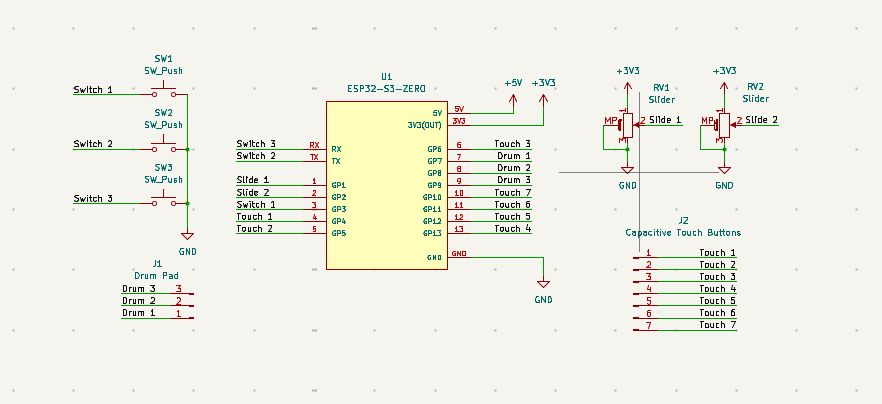
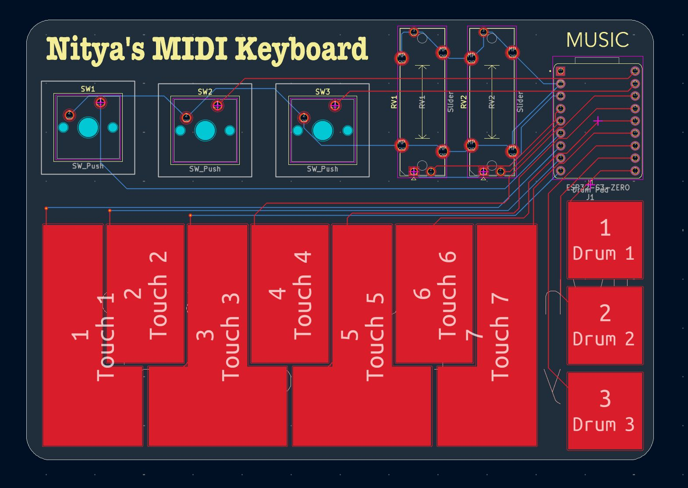
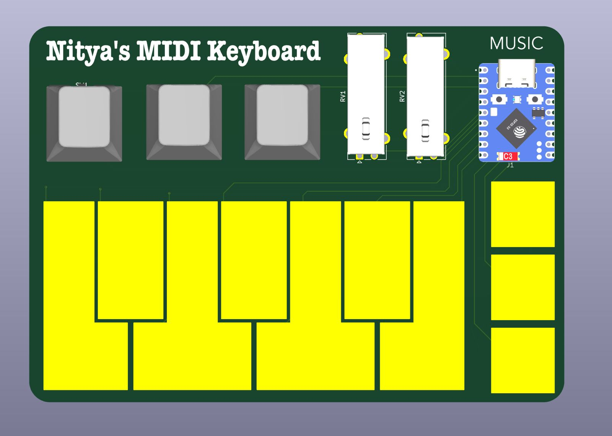
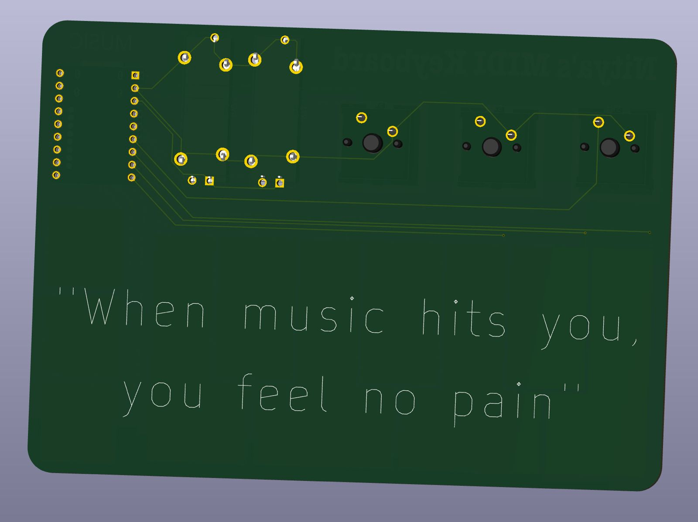

<h2>MIDI Keyboard</h2>

I created this MIDI Keyboard after inspiration from the HackClub Half Life challenge, midi keyboard guide for the Music themed week 3 project.

This includes 7 keys near the bottom left and 3 drum pads on the bottom right to play the songs you have always wanted to. 
It also includes 3 switches, one for going an octave higher, one for going an octave lower and the third one for sustaining the sound till held.
Lastly, it also includes 2 sliding potentiometers to adjust volume and modulation of the keyboard.

How this midi keyboard works is that whenever you press on the copper capacitive pads of the PCB the circuit is completed and our ESP32 S3 detects and sends commands
to the connected computer indicating what key is pressed. Then, accordingly the computer looks at the firmware and understands what sound to play because this key is 
pressed. This is basically how our keyboard works. Additional features go a bit more complex on how do they work but yeah this is the essential principle behind it.

For the drum pads, one is for kick, one is for snare and the last one is for hi-hat sound.

To build this project, order the pcb using the gerbers.zip file in the Production folder. Also order the required components for this as mentioned below:
<ul>
  <li> 1x Waveshare ESP32 S3</li>
  <li> 2x Bourns Sliding Potentiometer</li>
  <li> 3x Cherry MX Switches</li>
  <li> 3x Cherry MX Keycaps</li>
</ul>

This is all we need except the PCB for the project. Once you receive all the components and the pcb, solder them to their repsective positions. Then load the firmware
to the ESP32 S3 using the Arduino IDE. The firmware is present in the productions folder. To upload, select the required port and board in the Arduino IDE. You are free
to make changes to firmware to change any sounds or functions of the potentiometer or keys as you like. After uploading the firmware, keep the usb cable connected to the
computer and start pressing the keyboard keys and drumpads and experimenting this. Make your own songs and share them on  HackClub's Slack server.

 

 

<h4>Schematics</h4>

 

 

<h4>PCB Routing</h4>

 

 

<h4>PCB Front View</h4>

 

 

<h4>PCB Back View</h4>

